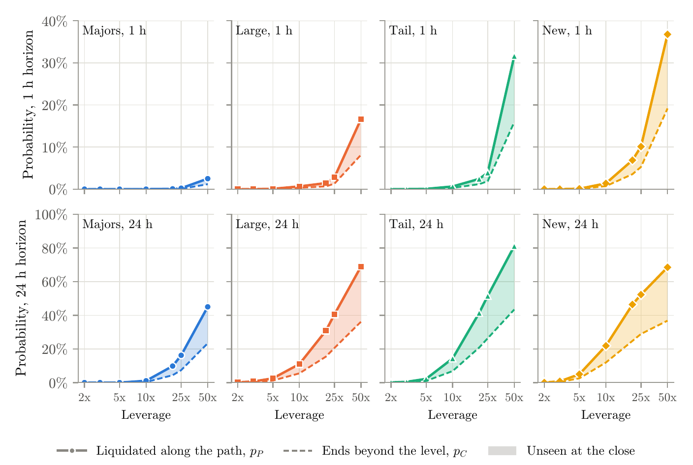
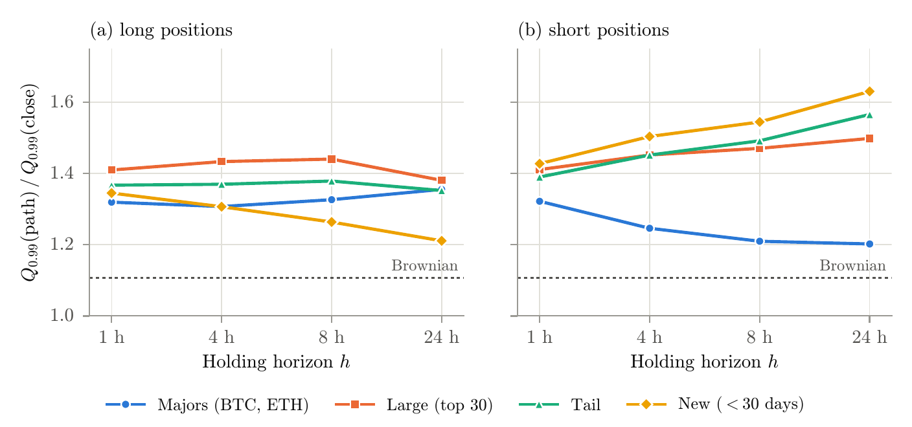

# Half of all liquidations are unseen at the close

Code and paper for *Half of All Liquidations Are Unseen at the Close: Path Risk versus Close-to-Close
Volatility in Crypto Perpetual Futures* (Ricardo Pérez Twerdy, November 2026). There are two editions
of the same study:

- [`paper/main.pdf`](paper/main.pdf), the **technical edition**, with the stochastic framework
  (first-passage times, reflection principle, proofs);
- [`paper/linkedin.pdf`](paper/linkedin.pdf), the **reader edition**, which explains the same ideas
  in words.

Both editions share one body (`paper/body.tex`), and every number in the text is generated from the
results.

Liquidation engines liquidate at the first touch of the liquidation boundary; close-to-close risk
measures see only where the price ends. On 12 months of 1-minute Binance mark prices (753 USDT
perpetuals, delisted ones included), about half of all liquidations happen in windows that end
inside the boundary, and the 99th-percentile adverse excursion is 1.20–1.63 times the
99th-percentile close-to-close loss (Brownian benchmarks: 1/2 and 1.107). Each contract uses
its own Binance maintenance-margin rate and maximum leverage.

Independent research, not affiliated with the author's employer. Not investment advice.

## Headline results


*Liquidation probability along the 1-minute mark-price path ($p_P$, solid) versus ending beyond the liquidation level at the close ($p_C$, dashed), by liquidity tier and leverage. Shaded band: liquidations unseen at the close.*


*Ratio of 99th-percentile intraday adverse excursion to 99th-percentile close-to-close loss across holding horizons, against the Brownian benchmark (1.107, dashed).*

## Reproduce

Requires [uv](https://docs.astral.sh/uv/) and, for the PDF, [Tectonic](https://tectonic-typesetting.github.io/).

```bash
uv sync --all-groups
uv run pytest -q
./scripts/reproduce.sh
```

`reproduce.sh` downloads the public data, runs the three analyses, builds the figures and tables,
and compiles the paper:

1. **Download.** About 31 GB from [data.binance.vision](https://data.binance.vision), roughly three
   hours. It is cached, so a re-run resumes where it stopped.
2. **Delisting cut and balanced cohort.**
3. **Analyses:** mark price, the balanced cohort, and last traded price.
4. **Figures, tables and `paper/main.pdf`.**

No API key is needed anywhere.

The venue leverage table is a snapshot of public market-data APIs taken on 22 November 2026,
committed as [`paper/data/venue_leverage.csv`](paper/data/venue_leverage.csv). Running
`uv run python -I scripts/venue_leverage.py` replaces it with today's values.

## Layout

| Path | What |
|---|---|
| `src/pathrisk/archive.py` | archive listing, checksum-verified download, CSV parsing; delisted symbols included |
| `src/pathrisk/universe.py` | point-in-time tiers (majors, large, tail, new) from trailing median turnover |
| `src/pathrisk/windows.py` | rolling holding windows from 1-minute bars: terminal return and running extremes |
| `src/pathrisk/liquidation.py` | liquidation boundary for linear perpetuals, isolated margin |
| `src/pathrisk/metrics.py` | breach counts, equal-weight aggregation, Brownian benchmarks, weighted quantiles |
| `src/pathrisk/bootstrap.py` | moving-block bootstrap over days |
| `src/pathrisk/pipeline.py`, `cli.py` | end-to-end study and the `pathrisk` command |
| `scripts/` | download, reproduce, venue snapshot, paper figures and tables |
| `paper/` | LaTeX source, generated figures and tables, PDF |
| `tests/` | unit tests, including a Brownian check of the whole metric chain |

## Method in brief

- **Windows.** A long and a short open every hour and are held for 1, 4, 8 or 24 hours on the
  mark price, the price Binance liquidates on. Windows with a missing minute are dropped.
- **Liquidation.** Equity `1/L + PnL` meets maintenance `m × mark notional`:
  - long: `d = (1/L − m)/(1 − m)`;
  - short: `d = (1/L − m)/(1 + m)`.

  `m` and the maximum leverage are each contract's first Binance bracket. A leverage level the
  contract doesn't offer is skipped.
- **Universe.** Rebuilt every day from information available before that day. Contracts under 30
  days old form their own tier, and each contract leaves the universe at its last trade.
- **Inference.** Each day counts once, and each contract once within a day. Confidence intervals
  come from a 7-day block bootstrap over days.

## Licence

MIT. See [LICENSE](LICENSE).
